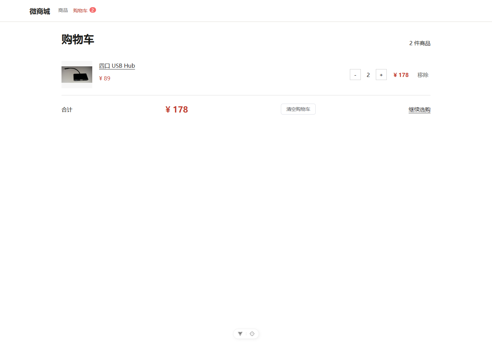
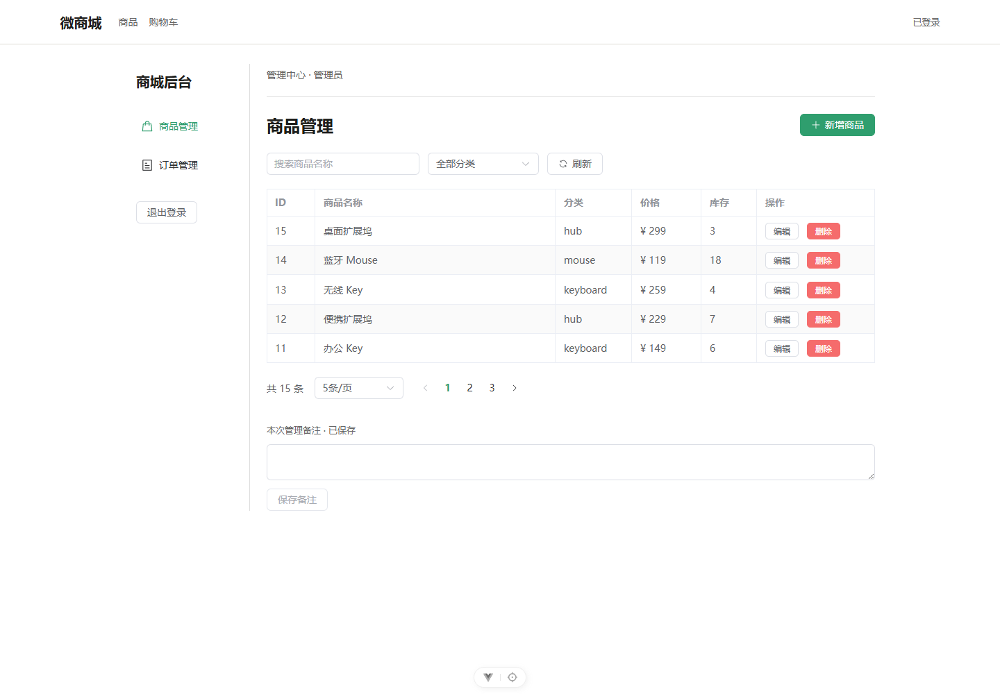
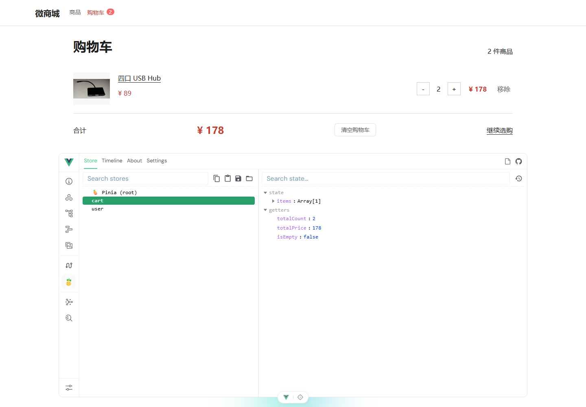
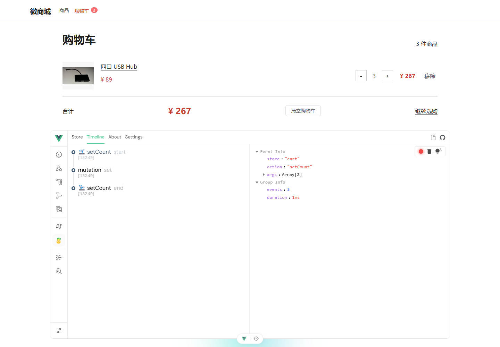

# 实验六：Pinia 状态管理与购物车全站贯通

姓名：谢鹏博　学号：2024036643041　班级：24软工国际-41

实验日期：2026 年 11 月 16 日。项目仓库：https://github.com/amnsicc/mall 。

## 实验目的

将购物车与用户会话迁入 Pinia，掌握组合式 Store、state、getters、actions、storeToRefs、持久化与 Vue Devtools 调试。完成商品列表、导航数量和购物车页面的数据同步，并验证登录守卫。

## 环境与运行

项目沿用第 10 周的 Vue、Vite、Vue Router、Element Plus、Axios 与 json-server，新增 Pinia 4.1.0、pinia-plugin-persistedstate 4.7.1 和 @vue/devtools-api 8.2.1。依赖版本见 pnpm-lock.yaml。

先运行 `pnpm install`，两个终端分别执行 `pnpm mock` 与 `pnpm dev --host 127.0.0.1 --port 4173 --strictPort`。商城地址为 `http://127.0.0.1:4173/#/products`，后台账号为 `admin / 123456`。

## 案例一：Pinia 与购物车 Store

在 `src/stores/index.js` 创建并导出 Pinia 实例，安装持久化插件。main.js 先注册 Pinia，再注册 Router，确保首次路由守卫可读取已恢复的用户状态。

`stores/cart.js` 的 items 是购物车唯一数据源。totalCount、totalPrice 和 isEmpty 是 getters。add、setCount、remove、clear 是 actions。原有 useCart 作为适配层，通过 storeToRefs 返回响应式引用，保留现有页面调用方式。

加购时保存商品 ID、名称、分类、图片、库存、价格与数量，价格采用加购时快照。重复商品比较时统一 ID 字符串，同一商品合并一行。数量只接受整数，忽略 undefined、NaN、小数和字符串，并限制在库存范围内，归零则移除。目录刷新时核对库存及已删除商品。

启用 persist 后，购物车状态保存到 Local Storage 的 cart 键。页面刷新时插件恢复条目，getters 重新计算件数和金额。

## 案例二：购物车全站贯通

ProductCard 保留 emit，由父组件转交 Store action。商品列表、工具栏、导航徽标、详情和购物车读取同一份状态。购物车支持数量增减、移除、合计、清空确认和空态入口。清空确认取消时保留数据，确认后通过 cart.clear 执行。

实测先加购同一商品两次，购物车只有一行、数量为 2。刷新后行、件数和总金额保持一致。

## 案例三：用户 Store 与守卫

`stores/user.js` 管理 token、profile 和 isLogin。user.login 调用现有登录 API，记录昵称与角色，页面返回原目标地址。后台顶栏显示管理员昵称，刷新后可恢复。

Router 守卫显式传入同一 Pinia 实例并读取 user.isLogin。退出与 HTTP 401 均通过统一会话动作清除用户状态。沿用第 10 周拦截器读取的 token 键，同时持久化 user Store，恢复时同步兼容键。useAuth 仅转接 Store。

## Devtools 调试证据

点击页面底部 Vue 图标进入 Devtools，选择 Pinia，查看 cart 与 user 两个 Store。cart 的 items、totalCount、totalPrice 和 isEmpty 可直接检查。

在 Pinia 的 Timeline 中开启录制，再点击购物车数量增加按钮，检查 setCount action 的调用与对应状态变化。

## 思考题：token 如何收敛为唯一数据源

当前实现沿用课件要求，用兼容 token 键对接第 10 周 Axios 拦截器。后续可以在独立模块导出 Pinia 实例，让 request.js 在请求时调用 useUserStore(pinia) 读取 token，401 统一执行 user.logout。初始化与依赖应保持明确，Store 的登录 action 可延迟导入 API，避免模块初始化时循环读取。确认旧版数据迁移完成后，再删除兼容 token 键及双写。

## 验证与结论

执行 `pnpm test`、`pnpm build` 和 `pnpm test:week11`。5 项 Node 测试、28 项第 11 周浏览器检查及生产构建通过，详细浏览器检查见 [week11-verification.json](week11-verification.json)。另运行原有完整商城回归，通过 64 项检查，结果保存为 [week11-regression.json](week11-regression.json)。购物车数量、跨页面状态、持久化、清空取消和登录守卫均通过实际操作验证。测试浏览器使用独立临时上下文。

实际排错时，Devtools Timeline 初始显示 No events，需要先点击录制圆点，变红后再触发 action。验证脚本通过实际事件名称判断成功，再保存截图。登录态还检查了服务返回受控 401 后，user Store 与兼容 token 同时清空，刷新后仍处于未登录状态。

本周课件讲解的项目结构还为订单确认、我的订单及后台订单用户管理预留边界，后续按前台功能、后台功能、整合测试逐步开发。资料目录尚未包含教材第 8 章原文，本段预习依据第 11 周讲义的项目概述与后续安排。

## AI 使用说明

使用 Codex 辅助实现、排错与检查，截图来自本机浏览器运行。个人信息沿用既有课程作业。代码与报告提交 GitHub。

参考资料为教师第 11 周讲义及三个案例源码，以及 [Pinia 官方说明](https://pinia.vuejs.org/getting-started) 和 [Vue Devtools 说明](https://devtools.vuejs.org/getting-started/introduction)。
